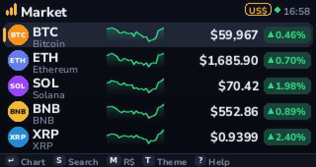
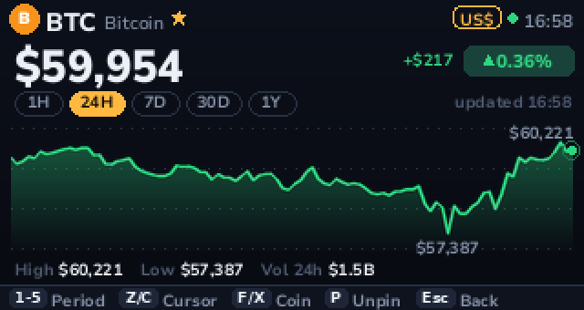
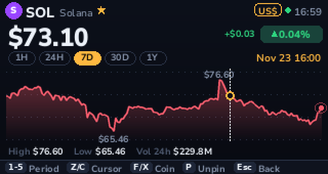
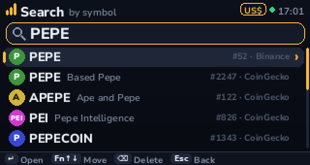
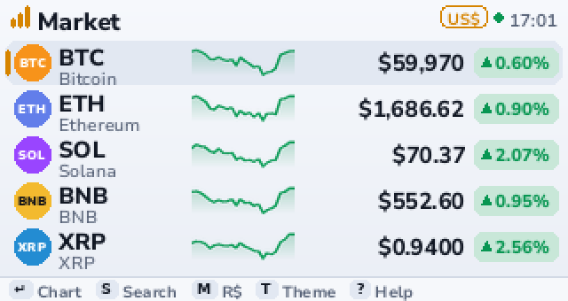
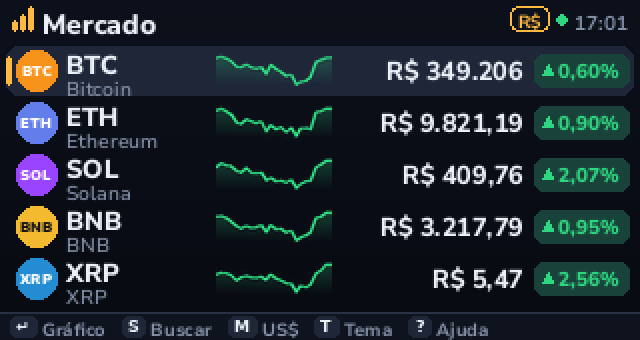

# criptomonitor-cardputerzero

**CriptoMonitor** is a crypto market monitor for the **M5Stack CardputerZero** (Debian, 320×170 screen).

<p>
  
  
</p>
<p>
  
  
</p>
<p>
  
  
</p>

## Features

- **Dashboard** with the top coins (BTC, ETH, SOL, BNB, XRP): price, 24h change and a 24h sparkline.
- **Search by symbol** (e.g. `PEPE`, `ADA`). Binance is the main source; CoinGecko adds names, rank and coins that aren't listed on Binance.
- **Charts** for 1H, 24H, 7D, 30D and 1Y with high/low, 24h volume and a cursor to inspect each point.
- **Pin favorites** to the dashboard (up to 12).
- **English (default) or Portuguese**, **US$ or R$**, dark or light theme. Settings are kept in `~/.config/criptomonitor/`.
- No account or API key needed.

## Keys

| Key | Action |
|---|---|
| F / X (or Fn+F/X) | move up / down (in search: Fn+F/X only) |
| Enter | open chart |
| S | search |
| 1–5 · Tab | chart period |
| Z / C | chart cursor (Home/End: first/last point) |
| F / X on a chart | previous / next coin |
| P | pin / unpin on dashboard |
| M · T · L · R | currency · theme · language · refresh |
| ? or Fn+H | help |
| Esc | back · hold to quit |

## Install

Download the `.deb` from the [releases](https://github.com/phor3nsic/criptomonitor-cardputerzero/releases), copy it to the device and run:

```sh
sudo apt install ./criptomonitor_1.1.0_all.deb
```

CriptoMonitor then shows up in the launcher. All dependencies (`python3-pil`, `python3-evdev`, `python3-requests`, `fonts-dejavu-core`) are standard Debian packages that come with the CardputerZero image.

## Build

```sh
packaging/build_deb.sh            # needs dpkg-deb + python3 (the device itself works)
```

On the CardputerZero over `adb shell`, run it as `TMPDIR=/tmp packaging/build_deb.sh`. The package lands in `dist/`.

To preview the screens on a desktop with live data (no framebuffer needed):

```sh
CRIPTO_FONT_DIR=/path/to/fonts python3 tools/preview.py /tmp/preview
```

`CRIPTO_FONT_DIR` should contain `NunitoSans-VariableFont_YTLC,opsz,wdth,wght.ttf` and/or DejaVu Sans. Without it, a fallback font is used.

## Architecture

One unprivileged Python process; no root and no background service. Pillow draws RGB565 straight into the framebuffer that APPLaunch provides (`APPLAUNCH_LINUX_FBDEV_DEVICE`). The keyboard is read through a shared evdev device (no grab), and Sym-layer symbols come from the official system keymap. Network requests run in a small thread pool, so the UI never blocks.

```
criptomonitor/
  app.py       UI state, key handling and screen rendering
  market.py    Binance (main) + CoinGecko (search/fallback)
  hw.py        RGB565 framebuffer + evdev keyboard
  theme.py     semantic palettes and fonts
  fmt.py       number/date formatting (en or pt-BR)
  i18n.py      UI strings (English default, Portuguese)
  settings.py  settings (atomic writes)
packaging/     launcher wrapper, .desktop, launcher icon, Debian control, build script
assets/        Store icon (256 px) and screenshots (320×170)
app-builder.json  CardputerZero Store manifest
```

## Store

`app-builder.json` holds the Store listing. It points to `assets/icon.png` (256×256) and six real 320×170 screenshots in `assets/screenshots/`, captured on the device with the app's own screenshot function. The share code is `CRPT`.

## Português

CriptoMonitor acompanha o mercado de cripto no CardputerZero: painel com as principais moedas, busca pela abreviação e gráficos de 1H a 1A. A interface abre em inglês; aperte **L** para trocar para português e **M** para ver os preços em reais.

## License

MIT, see [LICENSE](LICENSE) and [THIRD_PARTY_NOTICES.md](THIRD_PARTY_NOTICES.md).

Market data comes from the public Binance and CoinGecko APIs. It is for information only and is not financial advice.
